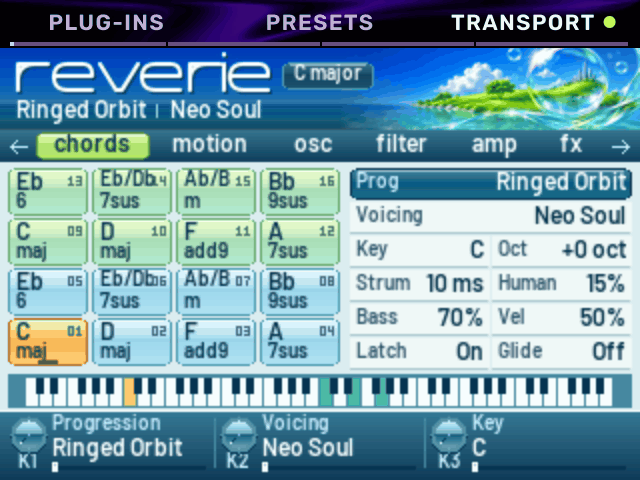
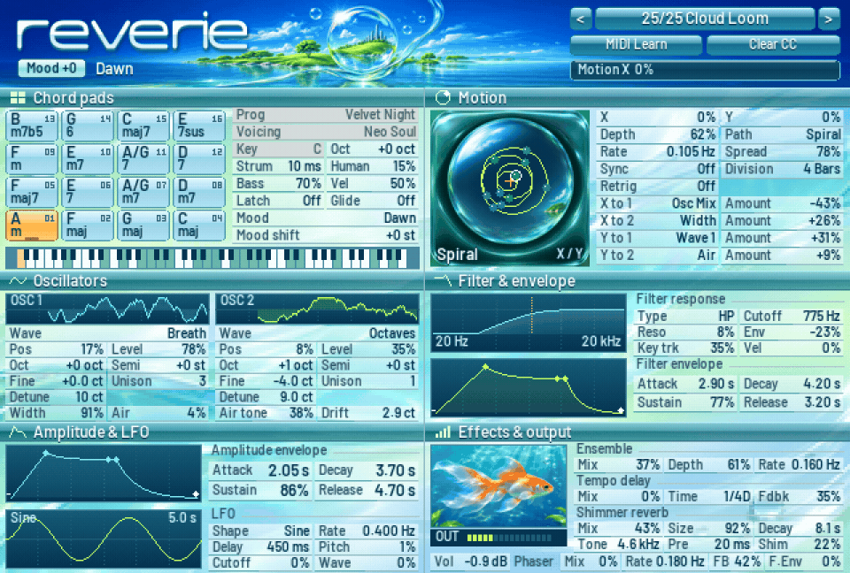
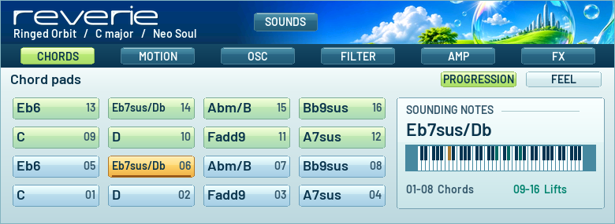
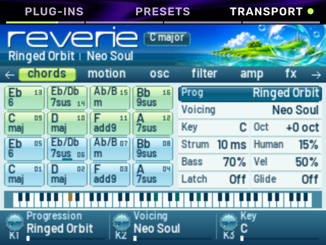
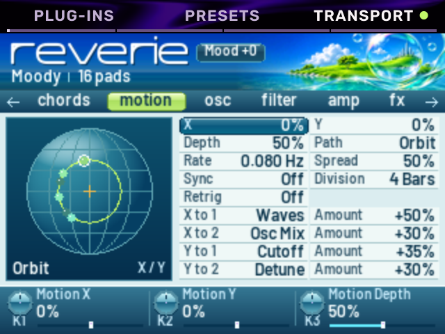
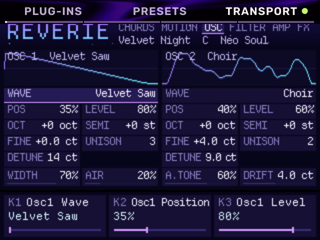

# hdslave Reverie

**A chord-progression and X/Y Motion pad synthesizer as a CLAP plug-in for the Akai MPC Sample.**

<table>
  <tr>
    <th width="25%">MPC Sample</th>
    <th width="48%">macOS and Windows · CLAP and VST3</th>
    <th width="27%">SP-16 · freesp16</th>
  </tr>
  <tr>
    <td align="center"></td>
    <td align="center"></td>
    <td align="center"></td>
  </tr>
</table>

[Download Reverie for MPC Sample, SP-16, macOS or Windows](https://github.com/hdslave/hdslave-Reverie-Synth/releases/latest). The release lists the matching firmware or desktop format for each build.

Built for the Akai MPC Sample running [Melodee](https://github.com/keremimo/melodee-sample) / [hdslaveOS](https://github.com/hdslave/hdslaveOS) (64-bit ARM Linux, Cortex-A55). New MPC tracks open on Velvet Night, the first of Reverie’s 46 original progressions. Each has six voicings and plays in any key. The 208 factory progressions remain available for saved projects. A Mood can override either bank with sixteen individually voiced chords. Built for huge, lush, evolving pads: dual morphing wavetable oscillators with unison, drift, and air, a per-note X/Y **Motion** path, an envelope-controlled stereo phaser, ensemble chorus, tempo-synced delay, and a big modulated shimmer reverb across six Frutiger Aero screen pages.

Inspired by Korg's M3 workstation (its X/Y MOTION pad, dual-oscillator programs, and chord-trigger pads), Reverie is an original design, not a model of the M3. Korg and M3 are trademarks of their owner; this plug-in is not made or endorsed by Korg. The Factory bank uses the chords of the M3's factory pad chord sets and of the chord sets of Pioneer DJ's TORAIZ SQUID sequencer (below); their names are Reverie's own. Pioneer DJ, TORAIZ and SQUID are trademarks of their owner, who does not make or endorse this plug-in either.

Hosts list it as **hdslave Reverie** (id `com.hdslave.reverie`, version 0.6.4). Not yet run on the MPC itself.

## Install

Copy `build/Reverie.clap` to the card as `Melodee/Plugins/hdslave/hdslave Reverie.clap`, with this README and the
licence files from `licenses/` beside it (as the staged card holds them: `hdslave Reverie - README.md` and so on).
Pick it on a PLUGIN track (SYNTH on Stage): Plugin, hdslave, hdslave Reverie. hdslaveOS reads Reverie's embedded drum map and sets the track to Drums. On stock Melodee 0.7.1 select Drums on Keys. With Drums selected, pad A01 is note 36, A16 note 51, whatever the key or the octave, and
hdslaveOS names them Chord 1-8 and Lift 1-8. The custom screen uses `melodee.screen/1` on Melodee 0.7 and hdslaveOS based on it. Open Edit on the plug-in track for the host controls, or select PANEL on Stage for Reverie’s Chords page.

## The pads

| Pads | What they play |
|---|---|
| A01-A08 (the bottom two rows) | the progression's eight chords, in order |
| A09-A16 (the top two rows) | the same eight chords **lifted**: voiced higher, each above its own chord, with one colour tone more where it fits |
| bank B (notes 52-67) | the sixteen again, an octave up; bank C two octaves up; the notes below 36 an octave down per bank |

A chord sounds while its pad is held. A pad struck again while it still holds its chord (Melodee sends on, on, off
when a step repeats) starts the chord fresh and lets the old one ring out. Two strikes of one pad on the same sample
play once, at the louder velocity; one struck, let go and struck again all on one sample plays its second strike.
A pad let go on the sample it struck (Melodee sends a note shorter than its 128-frame block that way, its on and off
together) plays its chord's first control tick, 16 samples, and then lets go, as a strummed note let go before its
turn does; every note plays, the bass too. A choke, All Sound Off or All Notes Off on that sample still means it never
sounds. (Before 0.6.4 it released from silence: the chord was silent, and with Strum the bass was dropped.)
A step the sequencer ties (or slides) goes on with no new attack, travelling at Chord Glide's pace — at once while
the legato pedal is down.

### Mood

Choose a set with **Mood** on the Chords page. The 18 SQUID chord sets retain the original bass notes, inversions and octave doublings on all 16 pads. Pad 1 plays database pad 1, through pad 16, following the pad numbers printed on Reverie. For example, in **Dawn**, pad 1 plays A3–C4–E4 and pad 9 plays F3–Ab3–C4. **Mood Shift** transposes the set from −12 to +12 semitones. At zero shift and octave, each pad plays in its original register.

Reverie’s panel greys out Prog, Bank, Voicing and Key while a Mood is selected. Choose **Off** to use their stored settings again. Octave, Bass, Strum, Humanize, Velocity, Latch and Glide work in both modes. A sound change keeps the selected Mood. Saving the project remembers both the set and its transposition.

### The chord section

On the Chords panel, set **Bank** to **Original** and **Mood** to **Off** to browse Velvet Night, Moonlit Two-Five, Sunday Sanctuary and the rest of the original bank. The standard Edit view puts the active Prog on its first knob. Its Chord Setup page holds Mood, Mood Transpose and Prog Bank. Both banks remember their last selection when you switch. Loading a sound preserves all chord settings.

| Control | What it does |
|---|---|
| PROG | choose one of the 46 Original progressions or one of the 208 Factory progressions in the selected bank |
| BANK | Original or Factory. New tracks start on Original. Projects saved in versions 0.3 through 0.6.0 reopen on Factory so the saved selection and its automation play as recorded in 0.6.0 |
| VOICING | how the chords are spread (below) |
| KEY | the key, C to B. The progressions are written in C (major or minor) and move to it; the chord names on the page are spelled in it (G# minor, not Ab minor). KEY itself reads that way too, on the page and in the host: Ab with a major progression, G# with a minor one. In the Factory bank the bass is voice-led between G1 and C3 |
| OCT | the whole chord up or down, -2 to +2 octaves |
| STRUM | the notes enter one after another, bass first, 0 to 150 ms apart. Let go of the pad before the strum is through and the late notes still play their turn, as long as the pad was held |
| HUMAN | a little velocity and timing jitter per note (up to about 20 ms late) |
| BASS | the bass note's level; at 0 there is no bass note at all |
| VEL | how much velocity sets the level (0: none, 100 %: all of it) |
| LATCH | a struck chord rings on after the pad is up, until the next chord; turning LATCH off lets go of it |
| GLIDE | Chord Glide: a chord struck while another is held (or latched) takes over its notes, and each slides to the new note over this time (0 to 3 s) without striking again; extra notes enter fresh, missing ones let go |

### Original progressions

The Original bank uses the same notes as desktop Reverie, including the bass and Lift voicings for every key and style. With Neo Soul and the key of C, Velvet Night opens with Fmaj9. Pad A01 plays F2, G3, C4, E4 and A4. A02 follows with Em9, A03 with Dm9 and A04 with G13.

| # | Name | Key | Chords (in C) |
|---|---|---|---|
| 1 | Velvet Night | major | Fmaj9 Em9 Dm9 G13 Cmaj9 Am9 Dm9 G9sus |
| 2 | Moonlit Two-Five | major | Dm9 G13 Cmaj9 Am9 Dm9 Db9#11 Cmaj9 A7#9 |
| 3 | Sunday Sanctuary | major | Fmaj9 F#dim7 Cmaj9/G A7b13 Dm9 G13sus G13 Cmaj9 |
| 4 | Tidal Hearts | major | Fmaj9 E7#9 Am9 Gm9 C13 Fmaj9 E7alt Am9 |
| 5 | Backdoor Bliss | major | Cmaj9 Fmaj9 Fm9 Bb13 Cmaj9 Am9 Dm9 G7b9 |
| 6 | Aurora | major | Cmaj9#11 Emaj9 Abmaj9 Fm9 Dbmaj9#11 Ebmaj9 Bb13sus Bb13 |
| 7 | Starlight Lydian | major | Cmaj9#11 D9/C Bm9 Em9 Am9 D13 Gmaj9 G9sus |
| 8 | Rose Quartz | major | Cmaj9 Bm7b5 E7b13 Am9 Gm9 C13 Fmaj9 Fm6/9 |
| 9 | Honey Drip | major | Em9 A13 Dm9 G13 Cmaj9 Fmaj9#11 F#m7b5 B7#9 |
| 10 | Neon Dusk | major | Fmaj9 G13 Em9 Am9 Dm9 G13 Cmaj9 C9 |
| 11 | Halo Ballad | major | Cmaj9 Gadd9/B Am9 Am9/G Fmaj9 Cmaj9/E Dm9 G13sus |
| 12 | Late Night Drive | major | Dm9 Em9 Fmaj9 Em9 Dm9 G13 Cmaj9 A7b13 |
| 13 | Crystal Cave | major | Am9 Fmaj9#11 Cmaj9 Gadd9/B Am9 Dm11 E7sus E7b9 |
| 14 | Golden Hour | major | Cmaj9 Gm9 C13 Fmaj9 Fm9 Bb13 Ebmaj9 G7alt |
| 15 | Cotton Clouds | major | Cmaj9 Em9 Fmaj9 Fm6/9 Em7b5 A7b13 Dm9 G13sus |
| 16 | Bossa Moon | major | Cmaj9 C#dim7 Dm9 D#dim7 Em9 A7b13 Dm9 G13 |
| 17 | Celestial Pedal | major | Cmaj9 Dadd9/C Bbmaj9/C Fmaj9/C Abmaj9#11/C Bbmaj9/C Fm6/9/C Cmaj9#11 |
| 18 | Silhouette | major | Fmaj9 Fm9 Em9 Eb9#11 Dm9 Db9#11 Cmaj9 G9sus |
| 19 | Neo Classic | major | Cmaj9 A7#9 Dm9 G7b13 Em9 A13 Dm9 G13sus |
| 20 | Prism | major | Dm11 Em11 Fmaj9#11 G13sus Am11 G13sus Fmaj9#11 Em11 |
| 21 | Ocean Floor | major | Cmaj9 Bbmaj9#11 Abmaj9 Bb13sus Cmaj9#11 Gm9 Fmaj9 Fm6/9 |
| 22 | Sanctuary Steps | major | Cmaj9 C13 Fmaj9 F#dim7 Cmaj9/G A7#9 Dm9 G13b9 |
| 23 | Afterglow | major | Cmaj9 G6/9/B Am9 Fmaj9#11 Cmaj9 Gadd9/B Am11 Fm6/9 |
| 24 | Firefly | major | Cmaj9 E7b13 Am9 C13 Fmaj9 D13 Dm9 G7b9 |
| 25 | Dorian Drift | major | Dm9 G13 Dm11 G13sus Em9 A13 Dm9 G13 |
| 26 | Glass Garden | major | Fmaj7#11 Em9 Ebmaj9#11 Dm9 Dbmaj9#11 Cmaj9 Bm7b5 E7alt |
| 27 | Silver Lining | major | Fmaj9 Em9 A7b13 Dm9 G13sus Cmaj9/E A7#9 Dm11 |
| 28 | Velvet Rope | major | Am9 Abmaj9#11 Gm9 C13 Fmaj9 E7#9 Am9 D9 |
| 29 | Heavenly Steps | major | Cmaj9 Ebdim7 Dm9 G13 Em11 A7b13 Dm11 G13sus |
| 30 | Paper Lanterns | major | Cmaj9 Am11 Fmaj9 G13sus Em9 Am11 Dm9 Fm6/9 |
| 31 | Daydream Descent | major | Dm9 Db13 Cmaj9 B7alt Bbmaj9#11 A7#9 Abmaj9 G13 |
| 32 | Amethyst | minor | Cm9 F13 Ebmaj9 Abmaj9#11 Dm7b5 G7b13 Cm11 Bb13sus |
| 33 | Midnight Dorian | minor | Cm11 F13 Bbmaj9 Ebmaj9 Abmaj9#11 Dm7b5 G7#9 G7b9 |
| 34 | Smoke and Velvet | minor | Cm9 Abmaj9 Ebmaj9 Bb13sus Fm9 Gm9 Abmaj9 G7alt |
| 35 | Obsidian | minor | Cm9 Dbmaj9#11 Bbm9 Abmaj9 Fm9 Dbmaj9 Dm7b5 G7b9 |
| 36 | Rainy Neo Soul | minor | Cm9 Fm9 Bb13 Ebmaj9 Abmaj9 Fm9 Dm7b5 G7#9 |
| 37 | Line Cliche | minor | Cmadd9 CmMaj9 Cm9 Cm6/9 Abmaj9 Fm9 Dm7b5 G7b9 |
| 38 | Nocturne | minor | Cm9 Abmaj9#11 Fm9 G7b13 Ebmaj9 Abmaj9 Dm7b5 G7#9 |
| 39 | Sapphire | minor | Dm7b5 G7b13 Cm9 C7#9 Fm9 Bb13 Ebmaj9 Abmaj9 |
| 40 | Witching Hour | minor | CmMaj9 Abmaj9#11 Fm9 Dbmaj9#11 Bbm9 Ebmaj9 Abmaj9 G7alt |
| 41 | Rose Petal | minor | Cm9 Bb6/9 Abmaj9 G7#9 Cm9 Bb13sus Abmaj9#11 G7b13 |
| 42 | Lunar Tide | minor | Cm11 Abmaj9 Ebmaj9 Bb6/9 Fm9 Gm9 Abmaj9 Bb13sus |
| 43 | Deep Indigo | minor | Cm9 Bbm9 Abmaj9 Gm9 Fm9 Gm9 Abmaj9 Bb13sus |
| 44 | Phantom Waltz | minor | Cm9 G7b13/B Cm9/Bb Am7b5 Abmaj9#11 Fm9 Dm7b5 G7b9 |
| 45 | Echo Chamber | minor | Cm9 F13 Cm11 F13sus Abmaj9 Gm9 Fm9 Bb13 |
| 46 | Moonstone | minor | Fm9 Bb13 Ebmaj9 Abmaj9 Dm7b5 G7alt Cm9 C7#9 |

### Factory voicings

Each chord is a bass note (the root, or a slash chord's bass) and an upper structure: the chord's most telling tones
(third and seventh first, then the colour tones and the fifth; the root left to the bass, except in a triad) placed in
the style's register. Pads A01-A08 play only the chord's own tones, so what the page names is what sounds. The bass
notes are chosen for the whole progression at once, between G1 and C3, so a bass line that steps, slides by a
semitone or stays put does not jump an octave in the middle (only a line that runs further than that range breaks,
once: 46 of the 2,496 progressions in a key). Of every way to place the upper tones, Reverie takes the one
that keeps the low register open (no thirds or seconds crowded down low), has no minor ninths except in b9 chords,
keeps the style's spacing, avoids a third or root on top, and moves least from the chord before it. The progression is
voiced in order twice round, so the eighth chord leads back into the first.

Pads A09-A16 (**Lift**) voice each chord higher, with one colour tone added when the chord has room for one that the
progression itself plays somewhere (a ninth on a triad or a major seventh, an eleventh on a minor chord...), so the
colour stays in the progression's scale; a chord with no such tone is lifted as it is. Rootless never plays the root of a
chord of four tones or more. Every progression is voiced in every style and key when Reverie is built (a table of
14,976 sets of sixteen pads), so picking one, or automating it on the same step as a chord, costs the audio thread
nothing.

| Voicing | Sound |
|---|---|
| Neo Soul | bass, then up to four tones close around middle C (the default) |
| Open | up to five tones spread wide, often in fourths and fifths (cinematic) |
| Close | up to four tones packed within an octave |
| Air | up to four tones high above the bass, a wide gap between |
| Quartal | up to four tones, preferring fourths between them |
| Rootless | no bass note: three to five tones, for playing over a bass line |

A chord plays only the tones its name holds (above the bass, the root only in a triad), so two pads in three play
three tones over the bass and a ninth or an eleventh four or five; the lifted pads add one more where the chord has
room.

For example, Ringed Orbit’s first four chords in Neo Soul are: C = C2 | C4 E4 G4, D = D2 | D4 F#4 A4,
Fadd9 = F2 | C4 G4 A4, A7sus = A2 | D4 E4 G4; lifted: C2 | C4 G4 D5 E5, D2 | D4 F#4 A4 E5, F2 | C4 G4 A4 D5,
A2 | E4 G4 B4 D5.

### Factory progressions

Each Factory progression is one of two makers' factory chord sets:

- **1-172, the M3's Pad 1-8 chord sets:** the Motion Synth combinations and programs first, then the Pad, SlowSynth
  and Vocal ones, in the order the factory banks hold them.
- **173-208, the SQUID's 18 Chord mode sets:** each set is 16 pads, so it gives two progressions, its pads 1-8 and
  then its pads 9-16, in the set's order. The sets come from the SQUID's own firmware (1.12), since its manual does
  not list them.

Each pad's chord is named from the pad's own notes, with a name whose tones are exactly its pitch classes (a fifth the
pad leaves out may sound), its lowest note as the bass (a slash chord when that is not the root). Each set is moved
so pad 1's root is C (minor when pad 1 is a minor chord), and KEY moves it from there. Sets that come back in other
presets, or in another key, are listed once. Reverie voices the chords in its own six styles, so a pad does not keep
the source's exact spacing and octaves.

`tools/make_progressions.py` makes this table and `src/progressions.h` from the two private chord packs (the M3
pack's `all-progressions.json`, the SQUID pack's `chord-sets.json`). Project states from 0.1–0.2 restore slots 1–46 in Original. Slots above 46 from the interim expanded bank fall back to Velvet Night. Later Factory states retain their stored index. The two current Prog controls have separate parameter IDs and ranges.

<!-- progressions: made by tools/make_progressions.py -->
| # | Progression | From | Key | Pads A01-A08 (in C) |
|---|---|---|---|---|
| 1 | Ringed Orbit | M3 | major | C D Fadd9 A7sus Eb6 Eb7sus/Db Abm/B Bb9sus |
| 2 | Signal Tower | M3 | minor | Cm7 Ebm7 Ab Gb B Ab7 F F9sus |
| 3 | Watchful Horizon | M3 | major | Cmaj7 Fm7 Gm7(11) Fm11/Ab Am7 Cmaj7/E G7sus/F G7sus |
| 4 | Low Cathedral | M3 | major | C Eb Bb F Bb Db Ab Bb |
| 5 | Frost Dawn | M3 | major | C Em/B Am Bm7/A C/G Cm/G D7/F# G9sus |
| 6 | Tender Embrace | M3 | major | C Cmaj7/G Am A7/E Dm F7 Cadd9/E G7/D |
| 7 | Starbound Voyage | M3 | minor | Cm Ab/C Bm7 Gm/Bb F/A Ab7b5 G G7/F |
| 8 | Spectral Prism | M3 | minor | Cm7 Gm7 Dbsus2 Fm7 Eb7sus/Db Abmaj9/C Fm7(11) Ebadd9/G |
| 9 | Neon Boulevard | M3 | minor | Cm Bb Fm Ab/Eb Db Bbm Fm Eb |
| 10 | Hidden Passage | M3 | major | Csus2 Fm7(11) Ebadd9/G Absus2 Dbadd9/F Ebadd11 Dbadd9 Bbm7 |
| 11 | Kinetic Drift | M3 | minor | Cm9 Fm9/Ab Ebmadd9/Gb Ebm7(11) Emaj9#11 Bsus2 Amaj9#11 Gb7sus |
| 12 | Prismatic Turn | M3 | minor | Cm7 Bbadd9/D Ebadd9 Fsus4 Gm F6 Bbadd11/Eb F7sus |
| 13 | Cell Division | M3 | minor | Cm Bb Eb Gm7 Abadd9 Bb Eb Bb |
| 14 | Sugar Village | M3 | minor | Cm Gm Db Eb Ab Bb7/Ab Eb G7/D |
| 15 | Horizon Fade | M3 | minor | Cm Bb/D Eb Ebadd9/G Abadd9 Ebmaj9/G Dbadd9 Absus2 |
| 16 | Chrono Shift | M3 | minor | Cm11 Ebm11 Bmaj9 Gbadd9/Bb Eadd9/G# Badd11/E Ebm11 Dbm11 |
| 17 | Tidal Formant | M3 | minor | Cm Bbm Abmaj7 Gbsus2 Abadd9 Db6/9 Fm9 Dbadd11/Gb |
| 18 | Resonant Pulse | M3 | minor | Cm9 Ab6/9 Gm7 Cm9/Eb F7sus G7sus Ab7sus Bb9sus |
| 19 | Quiet Machinery | M3 | minor | Cmadd11 Dbmaj7 Cm Ebm6 Fmadd9 Gbmaj7 Fm7/Ab Ebadd9/G |
| 20 | Folded Space | M3 | minor | Cmadd11/Eb G9 Ab Bbm/Db Fm/C Db Bbadd9 Cm/G |
| 21 | Mirror Steps | M3 | minor | Cm7 Dm7 Fm7 Gm7 Cm7 Dm7 Fm7 Gm7 |
| 22 | Neon Glyph | M3 | major | C Bbsus2#11 Am7 Fm7 Ebm Ebm7/Db B6 Fsus2/G |
| 23 | Temple Gong | M3 | minor | Cm Csus2 Gmadd11/C Am7/C Ab/C Abadd#11/C Gmadd11/C D7sus/G |
| 24 | Slow Bounce | M3 | minor | Cm Cm7/Bb F/A Fm/Ab Fm Dbmaj9 Dbmaj9/C C |
| 25 | Endless Ring | M3 | major | Csus2 Absus2 Fsus2 Dbsus2 Bbsus2 F#sus2 Ebsus2 Bsus2 |
| 26 | Last Departure | M3 | minor | Cm Ab Bb Gm Ab Fm Eb Bb |
| 27 | Eight Sides | M3 | major | C6 Am Em Dm7 C Bb G9sus A9sus |
| 28 | Voice Lattice | M3 | minor | Cm Db Gb E6 Dbsus2 Badd9 Bbm Ab7sus |
| 29 | Clockwork Lace | M3 | major | Csus2 Ebsus2 Dsus2 Fsus2 D7sus/C F7sus/Eb E7sus/D G7sus/F |
| 30 | Dice and Ivory | M3 | minor | Cm Fm Eb Gm Ab Eb/G Gb6 F7sus |
| 31 | Second Thoughts | M3 | major | Csus#4 C Em/B G/B A9sus Am7 D9sus D |
| 32 | Distant Broadcast | M3 | minor | Cm F/A Bbm Edim7 Bb/F D/F# Gm7 G |
| 33 | Sweeping Choir | M3 | major | Csus2 Fm Bbsus2 Ab F Db Ebadd9 F7sus/Bb |
| 34 | Gated Glow | M3 | minor | Cm7 F Cm/Eb F Bbm Abmadd11/Db Ebm Emaj7 |
| 35 | Phosphor Tide | M3 | minor | Cm Bb Fm7(11) Gm Cm Eb Bb Fm7(11) |
| 36 | Resin Rhythm | M3 | minor | Cmadd9 Dm Ebmaj7 F6 Fm6 Gm7/F Em7(11) G7/F |
| 37 | Light Steps | M3 | minor | Cm Eb Fm7 Bbsus4 Cm Cm7/Eb Fm G |
| 38 | Platform Clock | M3 | minor | Cm Bbadd9/C Dm7/C Cm Cmadd11/F Bb/F Fm Bb |
| 39 | Mischief Broth | M3 | minor | Cm Ebmaj7 Fm7(11) G7 F G Abmaj7 Bb7 |
| 40 | Slow Becoming | M3 | minor | Cm C9sus Cm7/Bb Gm7 Dm Eb Dm7 G |
| 41 | Water Voices | M3 | major | C Am Bbsus2/C Bb/D Csus2/D Cm/Eb Ab Fm |
| 42 | Liquid Ascent | M3 | major | C Em7/G Fmaj9/A Gadd9/B Fadd9/A G7 F Dmadd11/G |
| 43 | Shapeshift Cloud | M3 | major | C Em7/G Cadd9/E A7sus C6/9/G C6/9 C6/9/E C6/9/G |
| 44 | Timeless Expanse | M3 | minor | Cm11 Ebm11 Bbm11 Dbm11 Abm11 Bm11 F#m11 Am11 |
| 45 | Monarch Drift | M3 | minor | Cm Ab Bb/D Eb Abm Gb E Abmaj9/Bb |
| 46 | Fairy Lantern | M3 | major | C Eb/Bb Ebsus#4/Bb Ebmadd11/Ab Ebm7/Gb Bb/F Ab G/B |
| 47 | Freefall | M3 | minor | Cm Ebadd#11 Gm/D Cm/Eb Dbdim/E A/E Dm/F Fdim7 |
| 48 | Seed Pods | M3 | major | C G/B Am7(11) Em11 Dm11 Am11 Cadd11/F Fadd11/Bb |
| 49 | Skyward Glider | M3 | minor | Cm Eb6/9 Abmaj13 Gbmaj13 Ebm11 Gbmaj9sus/B Bbm11 Gm11 |
| 50 | Zephyr Cascade | M3 | minor | Cm11 Ebadd11/Ab Fm11 Abadd11/Db Bbm11 Dbadd11/Gb Ebm11 Gbadd11/B |
| 51 | Metamorphosis | M3 | minor | Cm7(11) F7sus/Eb Abmaj9 Cm7/Bb F7sus Ebadd11/Ab F7sus/Bb Fm7(11) |
| 52 | Moth Wings | M3 | minor | Cm7 Bbsus4 F/A Bb7sus/Ab Amadd11 Bbsus2#11 Gb7/Bb Bb |
| 53 | Circle of Dreams | M3 | major | C7sus F9sus Bb9sus Eb9sus Ab9sus Db9sus F#9sus B9sus |
| 54 | Spiral Stair | M3 | major | C7 C7sus Fadd11/A Bb Gmadd9 C6 Fadd#11 Fadd9 |
| 55 | Night Rotation | M3 | minor | Cm Cm7 Dm7/C Gm Gm7 Cm F9sus G7 |
| 56 | Lunar Capsule | M3 | minor | Cm7 Cmadd11/F Gmadd11 D7sus Ebadd9 C9sus Am7 G |
| 57 | Mirror Lake | M3 | major | C G Am Bbmaj7 Cm7/Bb Bbadd9/C Eb6 D/F# |
| 58 | Hummingbird | M3 | minor | Cm7 Abadd9 Gm/Bb Absus2 Ab Eb/G Fm7 Bb9sus |
| 59 | Sparkle Veil | M3 | minor | Cm6 Abmaj7/Eb Abmaj7#11/D Ebm9/Db Amaj9 Bmaj7#5/A# Abm7 G7 |
| 60 | Scattered Light | M3 | major | Csus2 Bbm7(11) Bb7sus/Ab Fsus2/G Fm7(11) F7sus/Eb Dbsus2 Cm7(11) |
| 61 | Stained Glass | M3 | major | C Bb F/A Ab6 Ebm Bbm/Db Ab G/B |
| 62 | Reed Whisper | M3 | major | C F C/G Fmaj7 F Em C G7 |
| 63 | Delayed Hours | M3 | minor | Cm Gm Bbm7 Fm7 Abm Ebm7 Bmaj7 Abm7 |
| 64 | Old Hymnal | M3 | major | C Csus2#11 Gsus4 G A A/C# G/D D |
| 65 | Stutter Choir | M3 | major | Csus4 Bbadd9/D Ebsus2 Fsus2 Gsus2 Fmadd9/Ab Bbsus4 Csus4 |
| 66 | Torchlight | M3 | minor | Cm Ebadd#11/A Bb Bb6 Cm7 F/C Dm G/D |
| 67 | Silk Ribbon | M3 | major | Csus4 C Dm7/C Edim/Bb F/A Emadd11/A Gmadd11/Bb Gm/Bb |
| 68 | Deep Sea Bloom | M3 | minor | Cm7/Bb Bbm7(11) Bmaj7/A# Bsus4 Bm7/A Am7(11) Asus4 Am7/G |
| 69 | Satellite Blink | M3 | minor | Cm7 Ebmaj7 Abmaj7 Fm7/Eb Dm7b5 Amadd11/D Dbmaj7 Bbm9 |
| 70 | Countdown | M3 | major | Cadd9 Db7sus E9sus Dbm7(11) Amaj9 B Gmaj9 F#m7(11) |
| 71 | Mercury Rain | M3 | minor | Cm Ebm Bb/D Dbadd#11 Ab/C Bmaj7 Eb/Bb Bb |
| 72 | Grid Shimmer | M3 | minor | Cm7 Gm7 Am7 Em7 Amaj7 Am7 Dm7/A G6 |
| 73 | Carefree Sway | M3 | minor | Cm Cm/Eb Fm G/B Fm G Ab6 Bbadd9 |
| 74 | Golden Avenue | M3 | major | Cmaj9 Dm7(11) G9sus G9 Dm9 Em7 Am7/G Am7/G |
| 75 | Bow and Gourd | M3 | minor | Cm7(11) Ab6/9 F9sus Bbm11/Db Cm9 Ebmaj9sus/Ab Cmadd11/F Gm7(11) |
| 76 | High Thermal | M3 | minor | Cmadd9 Gm7(11) Ebadd11/Ab Bb Fm7 C9sus Abadd11/Db G7sus |
| 77 | Spellbound | M3 | major | Cadd9 G/B Em D A Bm G A |
| 78 | Slow Crossfade | M3 | major | C Am6 Abmaj7 F Ebadd9 Dbmaj7 Ab G7 |
| 79 | Rain on Glass | M3 | major | Csus2 Ebsus2 Absus2 F#sus2 B6 Emaj7 Amaj7#11 Dmaj9#11 |
| 80 | Adrift | M3 | minor | Cmadd11/F Bb/F Fm Eb Dbmaj7 Cm7 Fmadd9 Ebadd9 |
| 81 | Vowel Moment | M3 | major | C Am/C Cadd9/D F Am Ddim/Ab C/G F#m7b5 |
| 82 | Cool Meadow | M3 | major | Csus2 Bbsus2 Fadd9 C Abadd9 Bbadd9 G7sus C |
| 83 | Closing Credits | M3 | minor | Cm Fm/C G7/B Eb/Bb Bbaug Bbm Cm7/Bb Adim |
| 84 | Wide Choir | M3 | major | Csus2 Abadd9/C Bbsus2/C Csus4 Bb11/Ab Fm7(11) C7sus/Bb G7sus |
| 85 | Moonlit Sleep | M3 | minor | Cm7(11) Abmaj13 Fm7(11) Abadd11/Db Gbadd9 Ebm7(11) Badd11/E Db7sus |
| 86 | Silicon Lullaby | M3 | minor | Cm7(11) Gm7(11) Abadd9 F Bbsus2 G7sus Eb6 Bbadd9/D |
| 87 | Orchestral Dawn | M3 | major | Cmaj9 D7sus Dm9/F Bbmadd9/Db Dbsus2/Eb F G9/F Ebmaj7#11/G |
| 88 | Warm Front | M3 | major | C Gmadd11/C Fmaj7/C Amadd11/D F6 Em7 Bm7b5/F G |
| 89 | Rising Voices | M3 | minor | Cm7(11) Gm7(11) Dbadd9/F C/Eb Cm/Eb Bbadd9/D Eb7sus/Db Abadd9/C |
| 90 | Velvet Quartet | M3 | major | C13sus F13 Bb13sus A7alt Dm11 Bb13#11 Abmaj13 Db13b9/G |
| 91 | Ripple Field | M3 | minor | Cmadd11/F Cm7 Dbmaj7/Ab Eb6 Dbmaj7/F Cm7 Dbsus2 Fm11 |
| 92 | Monastery | M3 | major | Cadd11 Cm11 Fadd11/C Abmaj9/C Dbmaj7/F F9sus Bbm9 Ebmaj7/Bb |
| 93 | Unending Bow | M3 | major | Cmaj7#11/B AmMaj7 Am7/G Cadd#11/F# E E7sus/D Cmaj7 Am6 |
| 94 | Cloud Bells | M3 | minor | Cmadd9 Abmaj9 Dm7(11) Dbmaj9 Gbmaj9#11 Dbmaj9/F Ebm7(11) Dbadd9/F |
| 95 | Infinite Choir | M3 | major | C Gmaj7/B Em Bm/D Cmaj7 Fmaj7 Bbmaj7 Abmaj7#11 |
| 96 | Dust and Light | M3 | major | C Am Dm Fadd9 F Em Dm Gsus4 |
| 97 | Trembling Air | M3 | major | C7 Fm Cm/Eb Dm7 Cm7/Bb Bb Ebsus4 Eb |
| 98 | Quiet Aside | M3 | minor | Cm F/A Bbadd9 C7/Bb Am A7/C# Dm G/B |
| 99 | Vintage Haze | M3 | minor | Cm9 Badd9/D# Ebadd9/G Ab7sus/Gb Ebsus2/F Amaj7b13/E Dm/G# Bmaj7#11 |
| 100 | Open Sky | M3 | major | Cadd11/F Bb6/9/F D9sus G7sus/C E9sus E9 Cadd9/G Gm7 |
| 101 | Bright Tomorrow | M3 | minor | Cm Am7b5 Abmaj7 Fm7 Ebm B Abm7 Bb |
| 102 | Digital Hearth | M3 | major | Cadd9/D Dm Amadd11/D Gm/D Ebadd9/G Fsus2/G Gm7(11) Ebadd9/G |
| 103 | Old Regrets | M3 | minor | Cm7 Fm7 Dbmaj7 Bb7sus Dm Eb Abmaj9 G9sus |
| 104 | Mellow Haze | M3 | major | Cadd9 Abmaj7 Bbadd9 Am Dm Cadd9 Abmaj7 G9sus |
| 105 | String Garden | M3 | major | C6/9 Ebmaj7#11 Bb6/9 Eb6/9 C7sus/F Fmaj7 Dm7 Fmadd9/Ab |
| 106 | Sine Lullaby | M3 | major | Cmaj9 Cm9 Abmaj7 Am7 Eb Dm7 Bbmaj7 Fmaj7/A |
| 107 | Suspended Hours | M3 | minor | Cmadd11/Eb Bbadd9/D Bbmaj7 Am7 Gm7 Fmaj7 Bbadd11/Eb D7 |
| 108 | Soft Daydream | M3 | minor | Cmadd9 Fm7 Ebmaj7/Bb Abmaj7 Gm7 Ab6/9 Bbadd9/F Gm |
| 109 | Glacier Breath | M3 | minor | Cm Ebm Bb/D Dm Fm Eb7 Abadd9 Eb |
| 110 | Trance State | M3 | minor | Cm Fm7 Eb Bb F Bbm Db6 Gm7 |
| 111 | Fond Memory | M3 | minor | Cm Gm F Cm7 Cadd9 Eb6 Abmaj9 G9sus |
| 112 | Ember Glow | M3 | minor | Cm7 Fm Dm7 G9sus A F Dm G9sus |
| 113 | Long Sweep | M3 | major | Cadd9 F6/9 Bb6/9 A7sus Dmadd9 Bbmaj7 Cm7/Bb G9sus |
| 114 | Closing Filter | M3 | minor | Cm9 Gaddb9/B Cm7/Bb Gm7 Fm Eb/G Db/Ab G |
| 115 | Thinning Air | M3 | minor | Cm Dm7 Eb F Gm Cm7(11) Dm7(11) Gadd9 |
| 116 | Hybrid Strings | M3 | minor | Cm7(11) Dm7(11) Fsus2 D7sus/G Bbm/Db F/C Eb/Bb Bb |
| 117 | Real and Ghost | M3 | minor | Cm Abadd9 Bb Cmadd11 Fm Cmadd9 Ab G7 |
| 118 | Honeyed Pad | M3 | minor | Cm7 Ebmaj7 Dm Gm Eb Ab Abadd11/Db Gm7(11) |
| 119 | Brass Clouds | M3 | major | C7/Bb Bb6/9 Am7 F/A Dm7 C F6 Gadd9 |
| 120 | Sea Breeze | M3 | minor | Cm Em7 Am9 Bm7 Eadd9 Badd9 Gsus2 B7sus |
| 121 | Comet Tails | M3 | minor | Cm Gm Bbm7 Fm7 Abm7 Bbm7 Db11/B G7b13 |
| 122 | Evocation | M3 | minor | Cm Bb Ab Fm Bb Cm Bb/D G/B |
| 123 | Ghost Voices | M3 | minor | Cm7(11) Bbadd9 Ab Gadd9 Amadd9 Gmaj7 Am7 Dadd9 |
| 124 | Whale Song | M3 | major | C6/9/E Gadd9/D D11/C Gmaj7/B Am11 Gmaj7 Cm13 D7sus |
| 125 | Angel Wings | M3 | minor | Cm9 Gadd11 Ebadd9 G9sus C Dm7(11) Am G |
| 126 | After Midnight | M3 | major | C7sus Bbm7(11) Ebmadd9/Gb Dbadd9/F Bmaj9/D# Dbadd11 Emaj9/G# Bbm7(11) |
| 127 | Easy Glow | M3 | minor | Cm F Bbm7 Fm7 G9sus A9sus Bb9sus G9sus |
| 128 | Hiss and Hum | M3 | minor | Cm Fm/C G/B Cm/Eb Fm D7/F# D7sus G/D |
| 129 | Molten Iron | M3 | minor | Cm Ebm Bbm/F Fm Db/Ab Abadd9 Bmaj7/D# Bbsus4 |
| 130 | Reed Organ | M3 | major | C Cm Csus4 Abm Fm7 Gm7 Bbm7 Cm7 |
| 131 | Brass Horizon | M3 | minor | Cm Abmaj7/C Eb/Bb Bb Fm7 Bb7sus/Ab Bbsus4 Bb |
| 132 | Slow Sine | M3 | minor | Cm Dm Gm Ebmaj9 Cm Bbmaj7 Am A7/C# |
| 133 | Vector Field | M3 | minor | Cm11 Dm11 Gm7 A7/G F/C Gmadd9/Bb Abmaj7 Gm7 |
| 134 | Ripple Tank | M3 | minor | Cm7 Gm7 Dbsus2 Fm7 Abm7(11) Ebm7 Bb7sus C7sus |
| 135 | Gentle Bowing | M3 | minor | Cm7 Bb6/9/D Fm7(11) Cm7(11) Gm7 Ebadd11/Ab Bbadd9 Bbm11/Db |
| 136 | Silent Hours | M3 | major | C7/Bb F/A B7/A E/G# A7/G D/F# G7 C |
| 137 | Sealed Letter | M3 | minor | Cm Cm7/Bb Fm/Ab Fsus2/G Ab Ddim/Ab Eb Dm7(11) |
| 138 | Stillness | M3 | minor | Cm Ab Fm Db Bbm Gb Ebm B |
| 139 | Old Photographs | M3 | minor | Cm7 Eb9sus Fm7(11) G7sus Absus2#11 Dbmaj9sus/Gb Gb9/E Bb9/Ab |
| 140 | Simple Sweep | M3 | minor | Cm11 Fm11 Dm11 G13b9 Cadd9 Dm7/C Abmaj9 Dbmaj9 |
| 141 | Wide Vista | M3 | minor | Cmadd11/F Bbm9 Ebm11 Absus2 Dbm11 Emaj9sus/A Ab7sus Dbmaj13/Gb |
| 142 | Scat Cafe | M3 | major | C7/6 B13b9 Bbmaj7 A13b9 Amadd11/D G11 C9sus Bbm6/9/A |
| 143 | Baritone Lounge | M3 | major | Cmaj13 Cm11/Eb Am9 D13b9 Gadd9 Bb13 Cm11/Eb D9sus |
| 144 | Soprano Smoke | M3 | minor | Cm7b5 F13b9 E13sus Amaj13 Ebm7b5 Ab13b9 Gb13sus B13b9 |
| 145 | Chapel Choir | M3 | major | C Bbadd9/D Ebsus2 D/F# Am7b5/G Gm Eb Bbmaj7/F |
| 146 | Circle of Fourths | M3 | minor | Cm11 Fm11 Bbm11 Ebm11 Abm11 Dbm11 F#m11 Bm11 |
| 147 | Breathing Aahs | M3 | minor | Cm9/Bb Dmaj7/A Bbmaj9/A Abmaj9#11 Cmaj7/G Cm7b5/Gb Gm9/F Dbmaj7/Ab |
| 148 | Soft Aahs | M3 | major | C Gmaj7/B Em Bm/D Cmaj7 Fmaj7 Bbmaj7 Ebmaj7 |
| 149 | Twin Oohs | M3 | major | Cadd9 Bbmaj13 Bb11/Ab Bbadd9/F Ebmaj7#11 Bbmaj7/D Ebmaj9/Ab Gm11 |
| 150 | Gentle Oohs | M3 | major | C Em F Am Bb Dm Eb Absus2 |
| 151 | Choral Mist | M3 | minor | Cdim/Eb Ab7 Db6 Abadd9/C Bbm Bbm7/Ab Gb6/9 Dbadd9/F |
| 152 | Steppe Voice | M3 | minor | Cm7(11) Bbm7(11) Fm7(11) Gm7(11) Gm/D F#m/C# Gm Bm11 |
| 153 | Birdsong Dawn | M3 | major | C/E Em Bm/D D Dm Am/C Am G |
| 154 | Tape Choir | M3 | major | C Cmaj7 F/C Fm/C Dm7 G7/D Dm7 G7 |
| 155 | Vowel Shift | M3 | minor | Cm Bb Ab Eb Ab Bb Bdim7 Cm |
| 156 | Highland Voices | M3 | minor | Cm9 Abmaj9 Fm9 Bbm9/Db Abmaj7/C Gbadd9/Bb Abadd9 Gbmaj7 |
| 157 | Alpine Echo | M3 | major | Cmaj7/B AmMaj7 Am7/G Cadd#11/F# E E7sus/D Cmaj7 Am6 |
| 158 | Dream Chorus | M3 | minor | Cm9 Am11 Gm9 Fmaj9 F#m9 Abm9 Gmaj9 Cmaj9 |
| 159 | Polar Night | M3 | minor | Cm Ab/C G/B Gm/Bb F/A Fm/Ab Dm7b5 G7 |
| 160 | Listening Post | M3 | minor | Cm Eb Gm Bdim Ab Fmadd11 Bbadd9/D G7 |
| 161 | Robot Hymn | M3 | minor | Cm7 Gm7 Ab Ebadd9 Ab/C Bb/D Eb Abadd11/Db |
| 162 | Machine Psalm | M3 | major | Cmaj7 Dm7 Ebm7 Em7 Fm Eb Dbmaj7 F#13 |
| 163 | Chrome Ballad | M3 | minor | Cm9 B7alt Bbm9 A7alt Abmaj7 Dbmaj9 Gm7b5 C7sus |
| 164 | Wired Dusk | M3 | minor | Cm C9sus Abmaj7/C C9sus Fm7 Gm7 Abmaj7 Bb |
| 165 | Steel Anthem | M3 | minor | Cm Ab Bb Gm Ab Fm7 Cm/G G7 |
| 166 | Synthetic Soul | M3 | minor | Cm Ebmaj7/Bb Abmaj7 G7sus Fm9 Dm7b5/Ab Cm/G G7 |
| 167 | Digital Gospel | M3 | major | Cmaj7 Fm9 Abmaj9 G9sus Fmaj9 Em7 Dm7(11) Cadd11/G |
| 168 | Neon Sermon | M3 | major | Cmaj9 Bbmaj9 Am7 Gm9 Fmaj9 Em7(11) Dm7(11) Dsus2/E |
| 169 | Static Prayer | M3 | minor | Cm Dm7/C Ab Absus2#11 Fm9 Dm/F Ab Bb |
| 170 | Carrier Wave | M3 | major | C7sus F/C Abadd9/C C9sus F9sus Fsus4 F7sus Fsus4 |
| 171 | Modulated Calm | M3 | major | Csus4 Cm Bbsus2 Bb Fm/Ab Ab6 Fsus2/G Gsus4 |
| 172 | Iron Lullaby | M3 | minor | Cm7 Fm9 Gaug C9sus Fm7 Gm7 Ab6 G7b13 |
| 173 | First Light | SQUID | minor | Cm Ab Bb Eb Abmaj7 G7 Cm7/Bb Fm7 |
| 174 | Early Hours | SQUID | minor | Cm Bm7 E7/D A7 F#m7b5 D6 Gmaj7 B7sus |
| 175 | Brooding Sky | SQUID | major | Cmaj9 Fmaj9 Em7 A7alt Dm7 Em/G A7/6 F#addb9/G |
| 176 | Overcast | SQUID | major | C9sus Bbm6 C13sus C7/6 Fadd9 Dbmaj9 Cm9 Bbm6/9/C |
| 177 | Amber Hour | SQUID | major | Cmaj7 Bm7 Em9 A7 Cmaj9 B7 Em7 A7 |
| 178 | Fading Sun | SQUID | major | Cmaj7 Bm7 Em7/D A7 Cmaj9 B7 Em9 A9sus |
| 179 | Last Goodbye | SQUID | minor | Cm7 Fm9 Bb9sus Ebmaj9 Abmaj7#11/D Bmaj7#5/G Bb7b9 F#dim7 |
| 180 | Empty Platform | SQUID | major | C7sus/Bb Am7b5 G7sus G7 Abmaj7 Bb7/Ab Gm7 C9sus |
| 181 | Flint Strike | SQUID | minor | Cm9 Am7b5 Fm9 Gm7 Cm9 Am7(11) Fm7 Gm7 |
| 182 | Live Wire | SQUID | minor | Cm7(11) Am7b5 Fm9 G7alt Cm7(11) Gsus2/A F9 G7b9b13 |
| 183 | Summit Path | SQUID | major | Cmaj7 B7 Em7 F#m7 Cmaj7 B7 Em11 Gmaj7 |
| 184 | Upward Spiral | SQUID | major | Cmaj9 B7b13 E9sus Eb9sus Cmaj9 B7b13 Em7(11) F#m7 |
| 185 | Open Road | SQUID | minor | Cm7 F9 Bb13sus C7sus Abmaj9 Gm7 Cadd9 Ebmaj9 |
| 186 | Far Shore | SQUID | minor | Cm7 Cadd9 C9sus Gm9 Ebmaj9 Ab13sus D7b13 D7b13 |
| 187 | Kind Hands | SQUID | major | Cmaj9 Amadd11/D Bm9 F#m7(11) Am9 D13b9 Gmaj9 Esus2/F# |
| 188 | Gentle Mercy | SQUID | major | Cmaj9 Asus2/B Abm7(11) Abm7(11) Em7 F#m7(11) B7sus Emaj7 |
| 189 | Light Wind | SQUID | major | Cmaj9 Gadd9/B Am7 Gmaj9 Dsus4 Bm7 Bbdim7 Fmaj9 |
| 190 | Paper Kites | SQUID | major | Cmaj7 B7alt Em7(11) D9sus Cmaj9 D13sus Em11 G7 |
| 191 | Schoolyard | SQUID | minor | Cm7 Fm7 Gm7 Abmaj7 Cm7 Fm7 Gm7 Ebadd11/Ab |
| 192 | Old Toybox | SQUID | minor | Cm9 Fm9 Gm7 Abmaj7 Cm11 Fm13 Gm7 Abmaj9 |
| 193 | Held High | SQUID | minor | Cm7 Bmaj7 B6 B6/9 Cm9 Bmaj9 Bmaj13 Bmaj13 |
| 194 | Victory Lap | SQUID | minor | Cm7(11) Bmaj7#11 Abm9/B Emaj7 Bbm9 Ebm9 Fm7 F7alt |
| 195 | Morning Prayer | SQUID | major | Cmaj7 Gadd11/B Am7(11) C7 Fmaj9 Cadd9/E Dm7 G13sus |
| 196 | Open Palms | SQUID | major | Cmaj7 F#7#9 Bbmaj7 C13sus Dadd9 Cadd9 Bbmaj7 Am7 |
| 197 | Lemon Sun | SQUID | major | Cmaj7 Fmaj7 Gadd11/C Fmaj9 Em7 Ebmaj7 Dm9 G13sus |
| 198 | Clear Skies | SQUID | major | Cmaj9 Bbmaj7 C9sus C7 Fmaj9 Cadd9/E Dm11 Cadd11/G |
| 199 | Snowfield | SQUID | major | Cmaj9 Gadd9/B Em7(11) Dbm7(11) Am11 D9sus Fsus2/G G7 |
| 200 | Frozen Lake | SQUID | major | Cmaj9 B7b13 Em7 A7 Am7 D7b9 G7sus G7 |
| 201 | Old Stones | SQUID | minor | Cm Abmaj7 Fm7 G7 Bbsus4 Bb Bb7sus Bb7 |
| 202 | Sunken City | SQUID | major | Cmaj9 B7b13 Em7 Am9 D9sus D7b9 Gmaj7 F#m7(11) |
| 203 | Thank You Note | SQUID | major | Cadd9 G/B Am7 Gm7 Fmaj7 Cadd9/E Dm9 G9sus |
| 204 | Warm Welcome | SQUID | major | C9 Cm7 D7 Bb7 Abmaj9 G9sus G Bbmaj9 |
| 205 | Zero Gravity | SQUID | minor | Cm7 Gm7 Fm7 G7b13 Ebm9 Bbm9 Abm9 Emaj9 |
| 206 | Soap Bubbles | SQUID | major | Cmaj9 Fm7 Bb9sus Ebm7 Abmaj9 D9sus G7b13 Cm9 |
| 207 | Full Steam | SQUID | minor | Cm9 F13sus Bbmaj9 Bbmaj9 Cm9 F13sus Bbmaj9 Gadd9 |
| 208 | Onward | SQUID | minor | Cm9 F9sus Bbmaj9 Eb13 E9sus A7alt D9sus Eb7b13/Db |

Left out (45 M3 sets): 1 with a cluster no chord name fits; 44 with power chords, octaves or single notes. Every SQUID set is in.
<!-- end of progressions -->

## Sound and parameters

**Oscillators.** Two, each with a WAVE (twelve sources made for pads), a POS (Position: each wave has four frames
and POS morphs across them), OCT, SEMI, FINE, UNISON (1-4 voices), DETUNE (the outer unison voices' spread, up to 50
cents) and LEVEL.

| Wave | Its four frames |
|---|---|
| Velvet Saw | soft, full, bright, and a glowing band |
| Hollow Pulse | square to a narrow pulse |
| Choir | the vowels Oo, Oh, Ah, Eh |
| Strings | a bowed string, the bow at four places, with a body |
| Drawbar | organ registrations: flute, jazz, full, gospel |
| Crystal | sparse high partials (glass) |
| Spectra | a resonant band swept up the harmonics |
| Octaves | octave stacks, then fifths among them |
| Warm | triangle to a soft square |
| Breath | dense, airy, formant-shaped |
| Reed | clarinet to oboe |
| Sine | pure, then gentle organ partials |

The frames share their harmonics' phases, so the morph is a smooth change of the spectrum, never a phasey dip.
Every frame is band-limited for each octave of pitch (no aliasing; images of the interpolation below -45 dB).

**Voice.** WIDTH spreads the unison across the stereo field (the upper notes of a chord also alternate sides; the
bass stays near the middle). AIR adds breath: a band of noise under each note's envelope (A.TONE moves the band).
DRIFT makes each oscillator wander in pitch, slowly, as analog ones do (up to 20 cents).

**Filter.** LP 12, LP 24, BP or HP (a state-variable filter, stereo), CUTOFF, RESO, ENV (the filter envelope's
depth, up to 6 octaves either way), KEYTRK and VEL (soft notes darker). LP 24 is two stages, the first without
resonance; switched back to LP 24 while a chord sounds, its second stage starts clean, as on the first switch.
(Before 0.6.4 it resumed from where it stopped, a burst: a peak of 0.976 against 0.794.) **Envelopes:** amplitude and filter, each
ATTACK, DECAY, SUSTAIN, RELEASE (up to 20 s).

**LFO.** One a note, each starting at its own phase (so a chord shimmers rather than wobbles together): SHAPE (Sine,
Triangle, Drift: a smooth random walk), RATE (0.05-20 Hz), DELAY (fades in over up to 5 s), and its depths to PITCH
(up to 50 cents), CUTOFF and WAVE (Position).

**Motion.** The X / Y pad, as the M3's MOTION records and plays a path on its X / Y pad. PATH picks the path (Orbit,
Figure 8, Pendulum, Spiral, Wander, Tide, Star, Lissajous; Off for none), RATE its speed (0.01-4 Hz; or SYNC to
the song, one turn every DIV), DEPTH its size, X and Y its centre (on the MOTION page K1 and K2: turn them by hand
and Melodee's motion recording keeps your gestures). SPREAD places each note of a chord at its own point of the
path, so the notes move apart and together; RETRIG starts the path again with each chord. The mod wheel moves Y. X
and Y each move two destinations (X>1, X>2, Y>1, Y>2, each with an amount): Wave 1, Wave 2, Waves (both), Osc Mix,
Cutoff, Resonance, Detune, Width, Air, Pitch (up to two semitones), Level, LFO Depth.

**Effects.** PHASER runs before the ensemble, delay and reverb. Its six all-pass stages create three moving notches. Mix brings in the effect, Feedback sharpens it, and Rate sets the stereo LFO from 0 to 3 Hz. F.Env follows the filter envelope of the newest sounding chord. Positive amounts sweep up on attack and back down on release. Negative amounts reverse that motion. Set Rate to 0 Hz for a sweep driven entirely by your playing. Mix defaults to zero when loading older projects.

ENSEMBLE (three modulated delays a side with a slow and a quick LFO, as string machines did: mix, depth,
rate), DELAY (ping-pong, its time a division of the tempo, its repeats darkening; mix, time, feedback), REVERB (an
eight-line feedback delay network, slowly modulated, with diffusion, a pre-delay and a high-pass ahead of it so the
low end stays clear: mix, size, decay up to 40 s, tone, pre-delay) and SHIMMER (the reverb an octave up, fed back
into it). VOLUME sets the level; a soft limiter keeps the output under 0 dBFS.

## The page

Use Minus and Plus to move through the six pages. [Watch the screen tour in hdslaveOS](docs/reverie-pages.gif). The wheel moves between controls. Push edits one; turn the
wheel to change it (Shift + wheel for fine steps, Minus and Plus for coarse) and Push again when done. On a switch,
Push flips it at once. K1-K3 hold the control picked and the next two. Hold Shift to see the controls.

The skyline shows the progression, voicing and key on every page. A green tab marks the page.
Blue glass marks the selected control and amber marks a control being edited. Each knob has a value marker.
A hollow amber marker shows where a physical knob sits while it waits for pickup.

| Page | What it holds |
|---|---|
| CHORDS | sixteen numbered pads in MPC order, blue for chords and green for lifts, amber while held, with the last strike underlined; PROG, VOICING, KEY, OCT, STRUM, HUMAN, BASS, VEL, LATCH, GLIDE; a keyboard with the notes that sound (the bass in gold), or the last chord's |
| MOTION | a glass globe with the X / Y path, its centre and a light for every sounding note; X, Y, DEPTH (K1-K3), PATH, RATE, SPREAD, SYNC, DIV, RETRIG and the four destinations |
| OSC | both oscillators, each drawn as its Position (and Motion) has it now; their controls; WIDTH, AIR, A.TONE, DRIFT |
| FILTER | the response, with the cutoff where the newest note has it, and the filter envelope |
| AMP | the amplitude envelope and the LFO |
| FX | phaser, ensemble, tempo delay and shimmer reverb grouped beside an aquarium with a live output peak meter |

The page draws nothing while nothing changes; while notes sound it moves at 25 frames a second.

## Sounds

Twenty-five, on Melodee's PRESETS page (and any host's preset browser). A sound sets every control but the chord
section. They are levelled to about -19 dBFS RMS for a held chord (Crystal Harp, a pluck, lower).

Reverie (the default), Velvet Nebula, Glass Cathedral, Choir of Moons, Silk Strings, Aurora Drift, Celestial Keys,
Deep Ocean, Starfield, Lo-Fi Dream, Gospel Glow, Breath of Angels, Velour Swell, Crystal Harp, Dark Matter, Sunrise
Bloom, Ethereal Vox, Mystic Reed, Polar Lights, Satin Keys, Undertow Wah, Opal Rain, Lantern Ferry, Cinder Cello and Cloud Loom.

Undertow Wah layers a low Choir oscillator with Hollow Pulse. A 315 ms filter envelope opens the phaser on each strike, and Motion brings the choir forward as you hold the chord. For the reference voicing in the Factory bank, choose Bow and Gourd in D with Quartal voicing, set Strum to 30 ms and play A03 for about 0.7 s. The Original bank and desktop equivalent is Velvet Night in C, Neo Soul, pad A08.

- **Opal Rain** pairs a glassy upper octave with a sustained triangle. Short filter decay softens the strike into a ringing chord.
- **Lantern Ferry** rocks between a flute and a hollow pulse over two beats, with a dotted-eighth echo answering the chord.
- **Cinder Cello** pairs a low bowed string with a reed. A band-pass filter and a slow reverse-envelope phaser move through the held chord.
- **Cloud Loom** swells from pitched breath into airy octave harmonics, with a high-pass filter and a long shimmer tail.

## Cost

The 0.6.3 AArch64 build averaged 3,855 guest instructions per silent block, 251,327 for a held chord, 379,619 during the progression, and 211,084 for Undertow Wah in QEMU at 48 kHz with 128-frame blocks.

The earlier Callgrind counts below use six-second renders at 48 kHz with 128-frame blocks. The estimated core share assumes one instruction per cycle on a 1.8 GHz Cortex-A55.

| Scene | Instructions | Share of one core |
|---|---|---|
| silent | 3,830 | 0.08 % |
| Undertow Wah chord, phaser Mix at zero | 198,775 | 4.14 % |
| same chord with the factory phaser setting | 211,432 | 4.40 % |
| one chord held, default sound | 252,524 | 5.26 % |
| the progression played, releases overlapping | 381,037 | 7.94 % |
| worst: all 24 voices (five lifted Open chords), unison 4 + 4, LP 24, every effect up | 1,045,897 | 21.8 % |
| the same, its pads rotating every block so stolen voices keep fading beside the 24 | 1,091,328 | 22.7 % |

The page costs about 77,000 instructions a frame on CHORDS and 110,000 on MOTION while it moves (25 frames a
second, on Melodee's screen thread, not the audio one). The oscillators read each morph as one 128-bit load a sample
(the frame and its difference to the next, interleaved) and mix in stereo pairs with NEON; the filter runs both
channels in one register; air is one noise for every voice; the control work (envelopes, LFOs, Motion, the knobs'
smoothing) runs every 16 samples and only while something moves; silent, Reverie sleeps. Clearing the effects (All
Sound Off, which Melodee sends on all 16 channels at once, the host's reset, falling asleep) does no work on their
lines: a cleared line only forgets what it held, and until it has been written through again the few places each
block reads that were not written since are zeroed first.

## Building and testing

`./build.sh` builds `build/Reverie.clap` and runs the tests in a Linux arm64 container (Melodee's `melodee-builder`
image in the `colima-melodee` Docker context; start it with `colima start melodee`).

- `tests/host.cpp` loads the plug-in as a host does: ports, every parameter and its text, state, the sounds (and
  that they leave the chord section alone), all 52,992 original pad voicings against the desktop note digest, and the factory bank in every voicing and key (239,616 chords: each a sound
  chord, the third there, only the chord's own tones on pads 1-8 and one colour tone more on 9-16, no root in Rootless,
  no stray minor ninths, a bass line that does not jump), every chord name fitting its pad, the pad map Melodee reads, chords from the pads and banks,
  Melodee's on-on-off and same-sample strikes, a pad struck and let go on one sample (the same to the bit as let go a
  tick later, with and without Strum, at any block size), strum, latch, sustain, Chord Glide, chokes and the channel modes
  (Reset All Controllers lifts the pedal), note-offs and chokes by note id, stolen voices fading without a step
  (at a block's start, twelve at once, a chord never taking its own notes, five chords on one sample taking the
  earliest one's), state recall across the Original, Factory and Mood banks, the effects cleared sounding exactly as
  wiped ones (and All Sound Off on 16 channels costing what one does), LP 24 left and come back to while a chord
  sounds (the same to the bit whatever its second stage did before), tuning at 44.1, 48 and 96 kHz, bounded output
  at every extreme, sleeping, and the page (it writes `build/screen-*.png`). It also checks the voicing table
  against the search, set by set.
- `tests/fingerprint.cpp` hashes every output sample over 58 scenes (`tests/fingerprint.txt`), including one in
  blocks of 1, 37, 128 and 4096 frames that must hash the same: the output does not depend on the host's blocks. A
  change meant to keep the sound must keep the hashes; `make fingerprint-update` records a change meant to change it.
- `./build.sh sanitize`: the host tests against an AddressSanitizer and UBSan build.
- `tools/bench.sh`: the cost table above.
- `./build.sh render` then `build/render build/Reverie.clap OUT.wav PLAYLIST`: renders progressions and sounds for
  listening (see `tests/render.cpp` for the playlist's lines).

## Licence

No project licence yet. The page uses Barlow SemiBold (SIL Open Font License, `licenses/OFL-barlow.txt`);
the CLAP headers are MIT (`third_party/clap/LICENSE`); `src/melodee_screen.h` is MIT.
