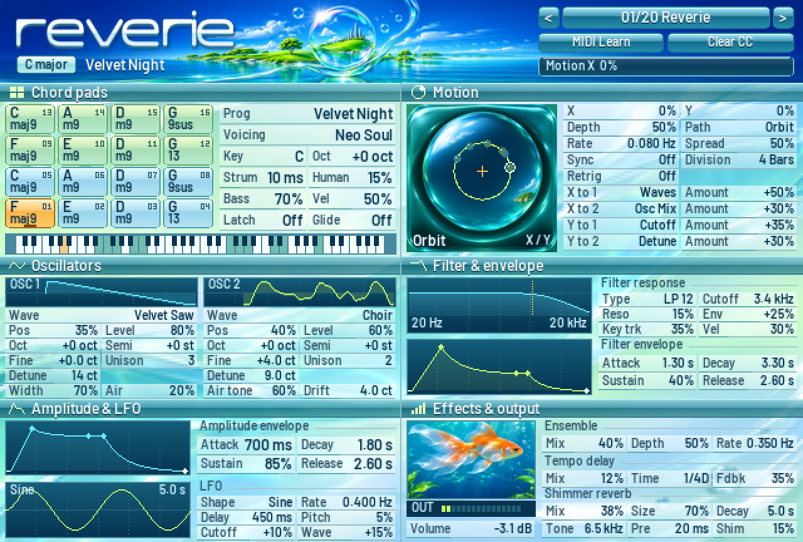
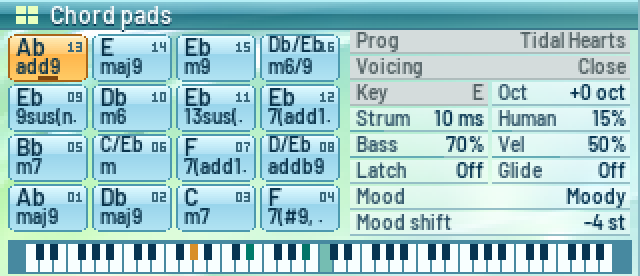

# hdslave Reverie for desktop

**hdslave Reverie** is a VST3 and CLAP instrument for macOS (Apple Silicon and Intel) and Windows (x64). Both formats include the complete synth and editor and can be installed independently.



Desktop version **0.3.5** opens at its smallest size, **960 × 648**, and keeps the panel’s 40:27 proportions when resized. The glass panorama holds the sound preset selector, MIDI Learn and the live parameter readout. The six sections below it give direct access to all 86 parameters. The sixteen pads audition the chord bank from A01 at the lower left through A16 at the upper right.

Drag or scroll a value to edit it. Shift-drag or right-drag for fine adjustments. Click a choice to advance it, double-click to restore its default, or right-click for its menu. Click MIDI Learn, select a parameter and move a MIDI controller to bind it. MIDI Learn accepts CC 0–119. Existing assignments in the Channel Mode range are preserved when loading a project. Actual MIDI mode messages bypass parameter mappings.

The **Phaser** row in Effects & output has Mix, Rate, Feedback (FB) and Filter Envelope (F.Env). Set Rate to 0 Hz to let the filter envelope drive the sweep with each chord. Turn F.Env negative to reverse it. **Undertow Wah** uses this routing to sweep a low Choir oscillator layered with Hollow Pulse. Try it on pad A08 of Velvet Night in C with Neo Soul voicing and a 30 ms strum.

The last four entries in the 25-sound preset menu are Opal Rain, Lantern Ferry, Cinder Cello and Cloud Loom.

## Progression and Mood

With **Mood** set to **Off**, **Progression** selects the 46 original progressions, from Velvet Night through Moonstone. Choose a key and one of six voicing styles. A01–A08 play the eight chords in order. A09–A16 play their lifted voicings.

On the Chord pads panel, choose a **Mood** to play any of the 18 SQUID chord sets, each with 16 original voicings. **Mood shift** transposes the set by up to an octave in either direction. Progression, Voicing and Key are greyed out while a Mood is selected. Choose **Off** to use their stored settings again. The set stays selected when you change sounds.



Hardware states saved with the Original progression bank recall their selected slot. To transfer a patch that uses a Factory progression, select an Original progression on the hardware and save a separate copy first. Desktop reports an unsupported Factory state without changing the current patch.

## Download and install

Each desktop ZIP contains CLAP, VST3 and four optional VST3 pad preset files. All 25 sounds are available in Reverie’s preset menu.

| Platform | Version 0.3.4 download | VST3 installation folder | CLAP installation folder |
| --- | --- | --- | --- |
| macOS 11 or later, Apple Silicon or Intel | [macOS ZIP](https://github.com/hdslave/hdslave-Reverie-Synth/releases/download/v0.6.3/Reverie-0.3.4-macOS-universal.zip) | `~/Library/Audio/Plug-Ins/VST3` | `~/Library/Audio/Plug-Ins/CLAP` |
| Windows x64 | [Windows ZIP](https://github.com/hdslave/hdslave-Reverie-Synth/releases/download/v0.6.3/Reverie-0.3.4-Windows-x64.zip) | `C:\Program Files\Common Files\VST3` | `C:\Program Files\Common Files\CLAP` |

Quit your DAW and extract the ZIP. For VST3, copy the entire `Reverie.vst3` bundle or folder. For CLAP, copy `Reverie.clap`. Create the installation folder if needed. In FL Studio, reopen the app, go to **Options → Manage plugins → Find installed plugins**, then add **hdslave Reverie** as a generator. The macOS downloads are ad-hoc signed and unnotarized.

## Build CLAP on macOS

Requires Xcode Command Line Tools and CMake 3.20+ (Ninja optional):

```bash
cd mac-clap
./build-macos.sh
./install-macos.sh
```

`install-macos.sh` builds, ad-hoc signs, tests, and installs `Reverie.clap` to `/Library/Audio/Plug-Ins/CLAP/` (pass `--user` to install to `~/Library/Audio/Plug-Ins/CLAP/`). Quit and reopen FL Studio after reinstalling so macOS reloads the updated bundle.

## Build CLAP on Windows x64

```powershell
cd mac-clap
.\build-windows.ps1
```

Copy `build\windows\clap\Release\Reverie.clap` to `C:\Program Files\Common Files\CLAP\`.

## Build VST3

Run these commands from `mac-clap/` with CMake 3.21 or later, Ninja, Git and a C++17 toolchain. CMake fetches the pinned adapter and SDK on first configure.

On macOS, build both architectures and sign the bundle locally.

```sh
cmake -S . -B build/vst3-mac -G Ninja -DCMAKE_BUILD_TYPE=Release -DREVERIE_BUILD_VST3=ON -DCMAKE_OSX_DEPLOYMENT_TARGET=11.0 '-DCMAKE_OSX_ARCHITECTURES=arm64;x86_64'
cmake --build build/vst3-mac --target ReverieVST3
codesign --force --sign - build/vst3-mac/vst3/Reverie.vst3
```

On Windows, use an x64 MinGW-w64 shell with GCC and Ninja on the path.

```sh
cmake -S . -B build/vst3-win -G Ninja -DCMAKE_BUILD_TYPE=Release -DREVERIE_BUILD_VST3=ON -DCMAKE_C_COMPILER=gcc -DCMAKE_CXX_COMPILER=g++ -DCMAKE_MODULE_LINKER_FLAGS=-static
cmake --build build/vst3-win --target ReverieVST3
```

Copy the complete `vst3/Reverie.vst3` directory from the chosen build folder to the VST3 installation folder above.

Build the `vst3_automation_test` target to check that the VST3 renders the same parameter transitions across two block sizes. Pass the full bundle path on macOS or the binary inside `Contents/x86_64-win` on Windows.
